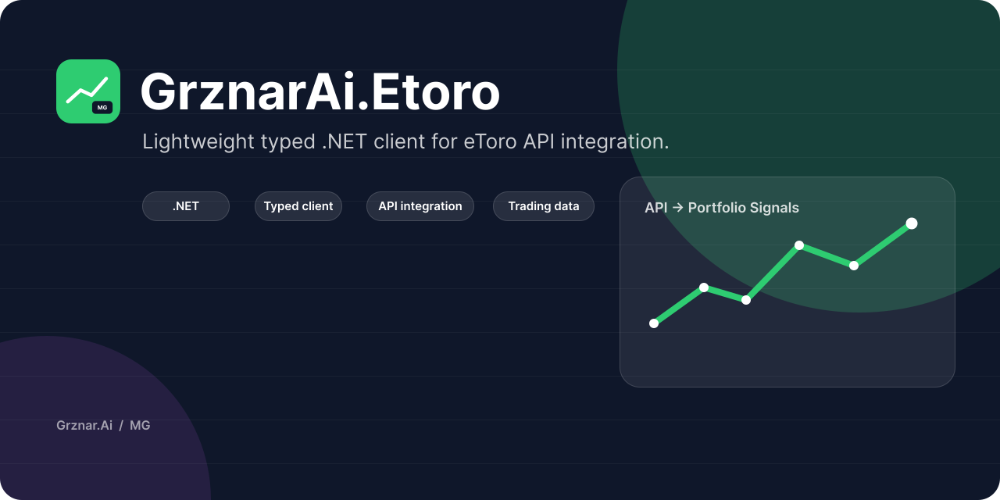

# eToro .NET Client



Typed .NET client library for the eToro public API.

NuGet package: `grznarai.etoro`  
Target framework: `.NET 9`  
License: MIT

This library gives .NET applications a small, typed wrapper around eToro API calls, including authentication headers, `HttpClientFactory` integration, request validation, rate-limit handling, API exceptions, portfolio/trading data, market data, user/social data, watchlists, feed posts, and account calculation helpers.

> This project is not affiliated with, endorsed by, or sponsored by eToro. Use it with your own eToro API credentials and follow eToro's API terms.

## Installation

```powershell
dotnet add package grznarai.etoro
```

## Quick Start

Configure credentials outside source control:

```powershell
dotnet user-secrets set "EToroOptions:ApiKey" "<api-key>"
dotnet user-secrets set "EToroOptions:UserKey" "<user-key>"
```

Register the client in `Program.cs`:

```csharp
using EToro.Client;

var builder = WebApplication.CreateBuilder(args);

builder.Services.AddEToro(builder.Configuration);

var app = builder.Build();
app.Run();
```

Use `IEToroClient` from DI:

```csharp
using EToro.Client;
using EToro.Models.Common;

app.MapGet("/portfolio", async (IEToroClient client, CancellationToken ct) =>
{
    var portfolio = await client.GetPortfolioAsync(EToroEnvironment.Real, ct);
    return Results.Ok(portfolio);
});
```

Use account calculations when you need derived metrics:

```csharp
using EToro.Models.Common;
using EToro.Services;

app.MapGet("/account-metrics", async (
    IEToroCalculationService calculations,
    CancellationToken ct) =>
{
    var metrics = await calculations.GetAccountMetricsAsync(EToroEnvironment.Real, ct);
    return Results.Ok(metrics);
});
```

## Configuration

Minimal `appsettings.json` (see also `appsettings.example.json`):

```json
{
  "EToroOptions": {
    "ApiKey": "replace-me-api-key",
    "UserKey": "replace-me-user-key",
    "Environment": "real",
    "BaseAddress": "https://public-api.etoro.com/api/v1/",
    "AllowCustomBaseAddress": false,
    "Timeout": "00:01:40",
    "UserAgent": "MyApp",
    "RateLimit": {
      "Enabled": true,
      "PermitLimit": 60,
      "Window": "00:01:00",
      "MaxRetries": 3,
      "RetryNonIdempotentRequests": false
    },
    "ErrorHandling": {
      "IncludeResponseBody": true,
      "RedactResponseBody": true,
      "MaxResponseBodyLength": 4096
    }
  }
}
```

Never commit real `ApiKey` or `UserKey` values. Use user secrets, environment variables, CI secrets, or your production secret store.

## Documentation

English:

- [Getting started](docs/en/getting-started.md)
- [Configuration](docs/en/configuration.md)
- [API reference](docs/en/api-reference.md)
- [Error handling](docs/en/error-handling.md)
- [Rate limiting and retries](docs/en/rate-limiting.md)
- [Account calculations](docs/en/account-calculations.md)
- [Testing and contributing](docs/en/testing-and-contributing.md)

Čeština:

- [Začínáme](docs/cs/getting-started.md)
- [Konfigurace](docs/cs/configuration.md)
- [API reference](docs/cs/api-reference.md)
- [Error handling](docs/cs/error-handling.md)
- [Rate limiting a retry](docs/cs/rate-limiting.md)
- [Výpočty účtu](docs/cs/account-calculations.md)
- [Testování a přispívání](docs/cs/testing-and-contributing.md)

## Current API Areas

- Trading: PnL, portfolio, closed trade history, orders, agent portfolios.
- Market data: exchanges, instrument types, instruments, search, rates, candles, closing prices, stock industries.
- User info: identity, profiles, user search, daily gain, gain history, live portfolio, trade info.
- Social: popular investors.
- Feed: instrument and user feed posts.
- Watchlists: own watchlists, default watchlist items, public watchlists, recommendations.
- Calculations: available cash, invested principal, unrealized PnL, realized PnL, equity, total return.

## Development

```powershell
dotnet restore
dotnet build
dotnet test
```

Integration tests require real eToro credentials and must keep secrets outside git.

## Contributing

Issues and pull requests are welcome. Keep changes focused, include tests for behavioral changes, and avoid committing credentials, generated build output, or local environment files.

## License

MIT License. Copyright (c) 2026 Michal Grznár.
